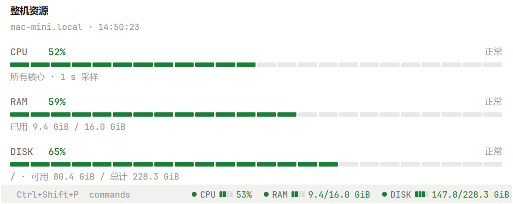

# Herdr System Stats

English · [中文](README.zh-CN.md)



CPU, memory and disk usage for Herdr: one line in the status bar, plus a details pane you can split
beside your terminals.

This is the old Herdr TUI plugin `faintghost.system-stats`, rebuilt for **herdr-app**, the Herdr
window. It is a **mod**: JavaScript on gpui-kit, no Go, nothing to compile.

The numbers are not local. A mod calls `exec(..., { on: machine })`, which goes through
`hc exec --on <machine>`, so the sampler runs on **the machine the shown space lives on**, with the
tools that system already has. A window on Windows still reports a Linux server's CPU, memory and
disk.

## What you need

- herdr-app (Windows, macOS, Linux)
- nothing to install on the machines you watch: Linux is read through `/proc` and `df`, macOS
  through `iostat`, `sysctl`, `vm_stat` and `df`, Windows through PowerShell and the WMI classes it
  ships with. No sudo, no daemon, no agent.

## Which numbers, per system

| | CPU | memory | disk |
|---|---|---|---|
| Linux | `/proc/stat`, two reads 250 ms apart | `/proc/meminfo` (`MemAvailable`) | `df -B1` |
| macOS | `iostat -c 2 -w 1`, user + system of the second sample (1 s) | `sysctl hw.memsize`, `vm_stat` free + inactive + speculative pages | `df -k` |
| Windows | `Win32_PerfFormattedData_PerfOS_Processor` (`_Total`), WMI's own counter | `Win32_OperatingSystem` (`TotalVisibleMemorySize`, `FreePhysicalMemory`) | `Win32_LogicalDisk` (`Size`, `FreeSpace`) |

Two details that decide what a reading means:

- **macOS disk** is the APFS container: `df /` lists only the sealed system volume (13 GB on a clean
  Mac), so the sampler takes `total − available` as used, the number `diskutil apfs list` prints.
  A 256 GB Mac therefore reads `245.1 GB` / `228.3 GiB` — what a formatted 256 GB drive holds — and
  about 65 % used. Finder can show a little more *available* than `df` does, because macOS counts
  purgeable space as free.
- **Windows disk** is a drive: `disks: ["C:", "D:"]`; the default `"/"` means the system drive
  (`%SystemDrive%`), and the panel labels it with the real letter.

## Install on Windows

A mod lives in the app's home, `%USERPROFILE%\.config\herdr-app` (`.config`, not `AppData`).
Drop the two folders in:

```
%USERPROFILE%\.config\herdr-app\
  mods\sysstats\main.js
  mods\sysstats\mod.json
  mods\sysstats-panel\main.js
  mods\sysstats-panel\mod.json
```

From PowerShell, copy them over from the machine that has this code (Windows 10/11 ship an OpenSSH
client):

```powershell
$mods = "$env:USERPROFILE\.config\herdr-app\mods"
New-Item -ItemType Directory -Force $mods | Out-Null

scp -r root@<host>:/root/pp/herdr-system-stats/mods/sysstats       "$mods"
scp -r root@<host>:/root/pp/herdr-system-stats/mods/sysstats-panel "$mods"
```

No scp? Create the two folders by hand and paste `main.js` and `mod.json` into them.

Easiest of all: download `herdr-system-stats-<version>.zip` from
[Releases](https://github.com/FaintGhost/herdr-system-stats/releases) and unzip it into `mods`
(the archive holds `sysstats\` and `sysstats-panel\`):

```powershell
Expand-Archive herdr-system-stats-2.0.0.zip -DestinationPath "$env:USERPROFILE\.config\herdr-app\mods" -Force
```

Check that the app loads them (mods hot reload; no restart needed):

```powershell
herdr-app check "$env:USERPROFILE\.config\herdr-app\mods\sysstats"
herdr-app check "$env:USERPROFILE\.config\herdr-app\mods\sysstats-panel"
```

Both print `check passed: …` when they are fine; a failure names the file and line.

## Put it in the status bar

Herdr replaces its shipped layouts on every start, so clone one first:

- in the app: `Ctrl+Shift+P` → **Duplicate layout** (gives you `main-copy`), or
- on the command line: `herdr-app do layout.clone --name main --as my-main`

Then edit `%USERPROFILE%\.config\herdr-app\layouts\main-copy.json` (`my-main.json`) and replace the
status bar near the end of the file:

```json
{ "id": "status", "type": "block", "size": { "px": 28 },
  "content": { "mod": "workspace-status" } }
```

with a row of two blocks:

```json
{ "id": "status", "type": "row", "size": { "px": 28 }, "children": [
    { "id": "status-bar",   "type": "block", "content": { "mod": "workspace-status" } },
    { "id": "status-stats", "type": "block", "size": { "px": 430 }, "content": { "mod": "sysstats" } } ] }
```

Save: the window follows within a second.

`430` is the order of magnitude for percentages and one disk. The used/total mode prints longer
readings (`115.2/147.2 GiB`), and every extra disk adds a `DISK /data` group; use about 520 then.

## The details pane

Split it like a terminal:

```powershell
herdr-app do pane.split --direction right --mod sysstats-panel
```

Prefer `--flag` arguments on Windows: PowerShell 5.1 tends to eat the double quotes of a JSON
argument.

## Use

- **Click the strip**: percentages ⇄ used/total (each mod remembers its own choice).
- It follows the machine of the shown space, the same one the status bar names next to
  `This computer`.
- To pin a machine, or report several disks, give the block props:

```json
{ "id": "status-stats", "type": "block", "size": { "px": 520 },
  "content": { "mod": "sysstats", "props": { "machine": "vps", "disks": ["/", "/data"] } } }
```

`machine` is a name from `hc machine ls`. Both mods take both props.

A machine is asked once which shell it speaks, and remembered: `sh` where it exists, otherwise
PowerShell. A Windows with Git's `sh` on `PATH` answers as MINGW and is sampled through PowerShell
anyway.

## How it maps to the TUI plugin

| TUI plugin | Here |
|---|---|
| `[ui].tab_bar_right` running `status` every 5 s | the `sysstats` mod, sampling every 5 s |
| the `watch` details pane (2 s) | the `sysstats-panel` mod, sampling every 2 s |
| red at ≥90, yellow at ≥75, green below | the theme's `ansi1` / `ansi3` / `ansi2` |
| four-cell `▰▱` meter | four rounded cells in the same colors |
| `prefix+u` toggles percent / used-total | click the strip |
| `--` / `○` when a reading is unavailable | the same |
| `pause` / `resume` actions | dropped: it only samples while shown |
| the `setup` pane (prints a config.toml snippet) | dropped: that one was for the TUI |

Wording follows the plugin: `整机资源`, `正常 / 偏高 / 高占用 / 不可用`, `已用 x / y`,
`可用 x / 总计 y`, `所有核心 · 250 ms 采样` — that last one names the window the CPU number covers,
so it reads `1 s 采样` on macOS and `WMI 计数` on Windows.

## When something is off

- `herdr-app status`: what the window shows and its `errors` — a mod's JavaScript errors land here.
- The strip shows `system stats: …`: that is the `exec` error (machine unreachable, no `sh`,
  timeout). While sampling fails the last numbers stay, dimmed.
- PowerShell missing, or blocked by policy, on a Windows machine: the strip says so and keeps the
  last numbers, dimmed. `Get-CimInstance` is all it needs.
- A slow first reading on Windows is normal: the first WMI call loads the performance archive
  (a few seconds). Later samples take about a second.
- Suspect the numbers? The samplers are plain shell: on Linux and macOS run
  `hc exec --on <machine> sh -c '<the POSIX script>' sh /`, on Windows
  `hc exec --on <machine> powershell.exe -NoProfile -Command '<the script>'`.

## Uninstall

Delete `mods\sysstats` and `mods\sysstats-panel`, and take the blocks out of your layout (or switch
back to `main`).

## Development

```sh
node --check mods/sysstats/main.js
node --test tests/*.test.mjs      # sampler, parser and formatting; no herdr-app needed
herdr-app check mods/sysstats     # load and render once in the real app
```

- A mod is a single file: herdr-app only promises `import "gpui-kit" / "gpui-base" / "herdr"`, so the
  sampling and formatting code is duplicated between the two mods and
  `tests/logic.test.mjs` fails if they drift apart.
- `gpui-kit.d.ts` is generated by the app for your editor and is not committed (`.gitignore`).
- The old Go implementation (the TUI plugin) was removed from this repository; it is still in the
  history (`git log --all -- main.go`). `1.1.0` was the last Go version.

## License

MIT, see [LICENSE](LICENSE).
