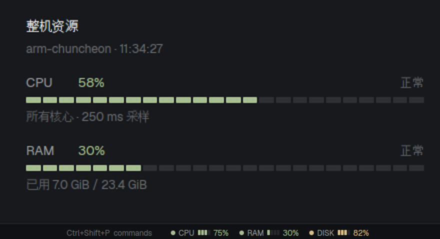

# Herdr System Stats

[English](README.md) · 中文



Herdr 的 CPU / 内存 / 磁盘用量显示：状态栏一行，外加一个可以 split 的详情面板。

这是旧版 Herdr TUI 插件 `faintghost.system-stats` 的复刻，但不再是 TUI 插件——Herdr 的窗口叫
**herdr-app**，它的扩展叫 **mod**，用 JavaScript（gpui-kit）写，不需要 Go、不需要编译。

数值也不是本机的：mod 通过 `exec(..., { on: machine })` 让 `hc exec --on <machine>` 在**当前 space
所在的那台机器**上采样（`/proc/stat`、`/proc/meminfo`、`df -B1`）。所以 Windows 上的窗口照样能显示
Linux 服务器的 CPU / 内存 / 磁盘。

## 需要

- herdr-app（Windows / macOS / Linux 都有）
- 被监控的机器是 Linux：要 `/proc`、`sh`、`awk`、`df`

## Windows 安装

mod 的家在 `%USERPROFILE%\.config\herdr-app`（注意是 `.config` 目录，不是 `AppData`）。
两个文件夹放进去就行：

```
%USERPROFILE%\.config\herdr-app\
  mods\sysstats\main.js
  mods\sysstats\mod.json
  mods\sysstats-panel\main.js
  mods\sysstats-panel\mod.json
```

在 PowerShell 里从放着这份代码的机器上拷（Windows 10/11 自带 OpenSSH 客户端）：

```powershell
$mods = "$env:USERPROFILE\.config\herdr-app\mods"
New-Item -ItemType Directory -Force $mods | Out-Null

scp -r root@<host>:/root/pp/herdr-system-stats/mods/sysstats       "$mods"
scp -r root@<host>:/root/pp/herdr-system-stats/mods/sysstats-panel "$mods"
```

不想用 scp 也可以手动建这两个文件夹，把 `main.js` 和 `mod.json` 贴进去。

最省事的还是压缩包：从 [Releases](https://github.com/FaintGhost/herdr-system-stats/releases) 下
`herdr-system-stats-<版本>.zip`，解压到 `mods` 里（包里就是 `sysstats\` 和 `sysstats-panel\` 两个文件夹）：

```powershell
Expand-Archive herdr-system-stats-2.0.0.zip -DestinationPath "$env:USERPROFILE\.config\herdr-app\mods" -Force
```

装完验证一下（app 会热加载 mod，不用重启）：

```powershell
herdr-app check "$env:USERPROFILE\.config\herdr-app\mods\sysstats"
herdr-app check "$env:USERPROFILE\.config\herdr-app\mods\sysstats-panel"
```

两行都输出 `check passed: …` 就成了；有错会指出文件和行号。

## 放进状态栏

自带的 layout 每次启动都会被 herdr-app 覆盖，所以先复制一份自己的：

- app 里按 `Ctrl+Shift+P` → **Duplicate layout**（得到 `main-copy`），或者
- 命令行：`herdr-app do layout.clone --name main --as my-main`

然后编辑 `%USERPROFILE%\.config\herdr-app\layouts\main-copy.json`（或者 `my-main.json`），
把文件底部这段：

```json
{ "id": "status", "type": "block", "size": { "px": 28 },
  "content": { "mod": "workspace-status" } }
```

改成一行两块：

```json
{ "id": "status", "type": "row", "size": { "px": 28 }, "children": [
    { "id": "status-bar",   "type": "block", "content": { "mod": "workspace-status" } },
    { "id": "status-stats", "type": "block", "size": { "px": 430 }, "content": { "mod": "sysstats" } } ] }
```

保存即生效，窗口一秒内跟着变。

`430` 只是量级：百分比模式 + 单个磁盘。切到“已用/总计”模式读数字更宽（`115.2/147.2 GiB`），
多一个磁盘还会多一块 `DISK /data`，那就把 px 加到 520 左右。

## 详情面板

跟终端一样 split 出来：

```powershell
herdr-app do pane.split --direction right --mod sysstats-panel
```

CLI 用 `--flag` 形式最省事；PowerShell 5.1 传 JSON 参数容易把双引号吃掉，能写文件就别写 JSON 串。

## 用

- **点一下统计条**：百分比 ⇄ 已用/总计（状态栏和面板各记各的）。
- 默认跟随当前 space 所在的机器，和状态栏左边那个 `This computer` / 机器名一致。
- 想钉死一台机器、或者报多个磁盘，在 layout 里给 props：

```json
{ "id": "status-stats", "type": "block", "size": { "px": 520 },
  "content": { "mod": "sysstats", "props": { "machine": "vps", "disks": ["/", "/data"] } } }
```

`machine` 是 `hc machine ls` 里的名字。两个 mod 都认这两个 props。

## 和 TUI 插件对应

| 旧 TUI 插件 | 现在 |
|---|---|
| `[ui].tab_bar_right` 里每 5 秒跑 `status` | `sysstats` mod，5 秒采样 |
| `watch` 详情面板（2 秒刷新） | `sysstats-panel` mod，2 秒采样 |
| ≥90 红 / ≥75 黄 / 其余绿 | 主题的 `ansi1` / `ansi3` / `ansi2` |
| 4 格 `▰▱` 计量条 | 4 个圆角小块，颜色同上 |
| `prefix+u` 切百分比 / 已用总计 | 点一下那一条 |
| 读数不可用显示 `--` / `○` | 一样 |
| `pause` / `resume` 动作 | 没搬：可见才采样，暂停没意义 |
| `setup` 面板（打印 config.toml 片段） | 没搬：那是写给 TUI 的 |

文案沿用插件：`整机资源`、`正常 / 偏高 / 高占用 / 不可用`、`已用 x / y`、`可用 x / 总计 y`、
`所有核心 · 250 ms 采样`。

## 出问题

- `herdr-app status`：窗口状态和 `errors`，mod 的 JS 报错在这里。
- 状态栏显示 `system stats: …`：那是 `exec` 的报错（机器不可达、没有 `sh`、超时）。
  采集中断时保留上一次读数，整行变暗。
- space 在本机（Windows）时读数不可用：采样只支持 Linux。
- 数字不对：`hc exec --on <machine> …` 就是它在跑的通道，先在终端里试
  `herdr-app check` 之外的那条：直接 `hc exec --on <machine> sh -c 'df -B1 /'`。

## 卸载

删掉 `mods\sysstats` 和 `mods\sysstats-panel`，再把 layout 里那两块删掉（或者直接切回 `main`）。

## 开发

```sh
node --check mods/sysstats/main.js
node --test tests/*.test.mjs      # 采样脚本 + 解析 + 格式化，不需要 herdr-app
herdr-app check mods/sysstats     # 真 app 加载一次并渲染，报错给到行
```

- 两个 mod 是单文件：herdr-app 的 mod 只保证 `import "gpui-kit" / "gpui-base" / "herdr"`，
  所以采样和格式化那一段两边是复制的，`tests/logic.test.mjs` 会检查它们没跑偏。
- `gpui-kit.d.ts` 是 app 生成给编辑器看的，不进仓库（`.gitignore` 里）。
- 旧版 Go 实现（TUI 插件）已从这个仓库移除，历史里还在：`git log --all -- main.go`；
  `1.1.0` 是最后一个 Go 版本。

## License

MIT，见 [LICENSE](LICENSE)。
